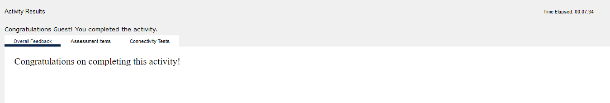

**Module:** IT533 Module 13, addressing
**Tools:** Cisco Packet Tracer
**Devices:** PC1, PC2, PC3 and PC4 on the 192.168.1.0/24 office network, a wireless router, Router0, the ISP router, and the DNS and web servers on 192.15.2.0/24
**Time:** 7 minutes 34 seconds (Packet Tracer timer)
**Score:** completed; this activity has no scored items

## What the lab asked for

A small business owner can't reach the internet from one of the four PCs in the office. All four are configured with static addresses on 192.168.1.0/24 and should be able to reach the www.cisco.pka web server. Run `ipconfig /all` on each PC, record the IP address, subnet mask and default gateway, find the one that is wrong, and fix it from Desktop > IP Configuration.

## What I found

`ipconfig /all` on each PC, before the fix:

| PC | IPv4 address | Subnet mask | Default gateway | DNS server |
|---|---|---|---|---|
| PC1 | 192.168.1.101 | 255.255.255.0 | 192.168.1.1 | 192.15.2.5 |
| PC2 | 192.168.10.102 | 255.255.255.0 | 192.168.1.1 | 192.15.2.5 |
| PC3 | 192.168.1.103 | 255.255.255.0 | 192.168.1.1 | 192.15.2.5 |
| PC4 | 192.168.1.104 | 255.255.255.0 | 192.168.1.1 | 192.15.2.5 |

PC2 is the one. Its address is 192.168.10.102, which with a /24 mask puts it on the 192.168.10.0 network, while its gateway 192.168.1.1 is on 192.168.1.0. The PC and its gateway are on different networks, so PC2 can never reach the router and never gets off the LAN.

## The fix

On PC2, Desktop > IP Configuration: changed the IPv4 address from 192.168.10.102 to **192.168.1.102**. Mask 255.255.255.0 and gateway 192.168.1.1 stayed as they were. After the change all four PCs are on 192.168.1.0/24 with the same gateway.

The addresses above come from my saved .pka: the activity's starting network holds the original values, and my saved network holds the corrected ones.

## Proof it worked

