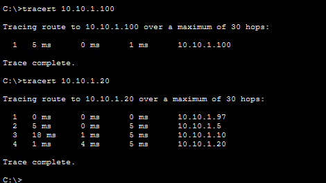
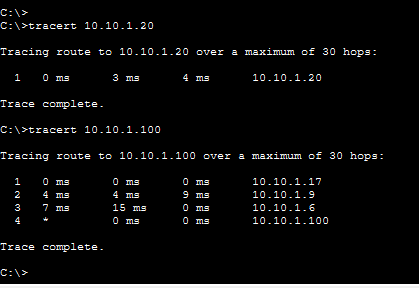
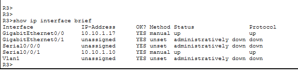
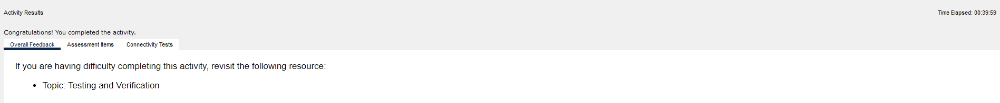
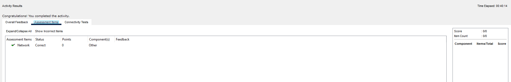

**Module:** IT533 Module 13, addressing
**Tools:** Cisco Packet Tracer
**Devices:** PC1 and PC2 at opposite ends of three routers (R1, R2, R3) joined by two serial links, running IPv4 and IPv6 side by side
**Time:** 40 minutes (Packet Tracer timer)
**Score:** completed; this activity has no scored items, the grade is the answers

## What the lab asked for

Dual-stack lets IPv4 and IPv6 run on the same network. The routers come already configured. The job is to document and test it in three parts: fill in the addressing table for the two PCs with `ipconfig /all` and `ipv6config /all`, test connectivity both ways with ping over IPv4 and IPv6, and trace the path end to end with tracert, naming the interface behind every address along the way.

## The addressing table

The PC rows are what I collected. The router rows are from the lab, and they match the router configs in my saved .pka.

| Device | Interface | IPv4 address | Mask | IPv6 address | Default gateway |
|---|---|---|---|---|---|
| R1 | G0/0 | 10.10.1.97 | 255.255.255.224 | 2001:db8:1:1::1/64 | N/A |
| R1 | S0/0/1 | 10.10.1.6 | 255.255.255.252 | 2001:db8:1:2::2/64 | N/A |
| R2 | S0/0/0 | 10.10.1.5 | 255.255.255.252 | 2001:db8:1:2::1/64 | N/A |
| R2 | S0/0/1 | 10.10.1.9 | 255.255.255.252 | 2001:db8:1:3::1/64 | N/A |
| R3 | G0/0 | 10.10.1.17 | 255.255.255.240 | 2001:db8:1:4::1/64 | N/A |
| R3 | S0/0/1 | 10.10.1.10 | 255.255.255.252 | 2001:db8:1:3::2/64 | N/A |
| PC1 | NIC | 10.10.1.100 | 255.255.255.224 | 2001:DB8:1:1::A/64 | 10.10.1.97 and FE80::1 |
| PC2 | NIC | 10.10.1.20 | 255.255.255.240 | 2001:DB8:1:4::A/64 | 10.10.1.17 and FE80::3 |

Link-local addresses on the routers: R1 fe80::1, R2 fe80::2, R3 fe80::3.

## What I typed

On the PCs, in the Command Prompt: `ipconfig /all` and `ipv6config /all` for the table, pings to the other PC over IPv4 and IPv6, then the traces.

From PC1:

```
tracert 10.10.1.20
tracert 2001:db8:1:4::a
```



From PC2:

```
tracert 10.10.1.100
```



On R3, to settle which serial port holds 10.10.1.10 (the only router command in my .pka's command log):

```
R3>show ip interface brief
```



## The lab's questions

My answers, as I wrote them down during the lab.

**Part 2, ping over IPv4**

**From PC1, ping the IPv4 address for PC2. Was the result successful?** Yes, the ping was successful.

**From PC2, ping the IPv4 address for PC1. Was the result successful?** Yes, the ping was successful.

**Part 2, ping over IPv6**

**From PC1, ping the IPv6 address for PC2. Was the result successful?** Yes, the ping was successful.

**From PC2, ping the IPv6 address of PC1. Was the result successful?** Yes, the ping was successful.

**Part 3, the IPv4 path**

**From PC1, trace the route to PC2. What addresses were encountered along the path?** 10.10.1.97, 10.10.1.5, 10.10.1.10, 10.10.1.20

**With which interfaces are the four addresses associated?** R1 G0/0, R2 S0/0/0, R3 S0/0/1, & PC2 Fa0

**From PC2, trace the route to PC1. What addresses were encountered along the path?** 10.10.1.17, 10.10.1.9, 10.10.1.6, 10.10.1.100.

**With which interfaces are the four addresses associated?** R3 G0/0, R2 S0/0/1, R1 S0/0/1, & PC1 Fa0

**Part 3, the IPv6 path**

**From PC1, trace the route to the IPv6 address for PC2. What addresses were encountered along the path?** 2001:DB8:1:1::1, 2001:DB8:1:2::1, 2001:DB8:1:3::2, 2001:DB8:1:4::A

**With which interfaces are the four addresses associated?** R1 G0/0, R2 S0/0/0, R3 S0/0/1, & PC2 Fa0

**From PC2, trace the route to the IPv6 address for PC1. What addresses were encountered along the path?** 2001:DB8:1:4::1, 2001:DB8:1:3::1, 2001:DB8:1:2::2, 2001:DB8:1:1::A

**With which interfaces are the four addresses associated?** R3 G0/0, R2 S0/0/1, R1 S0/0/1, & PC1 Fa0

## Proof it worked




