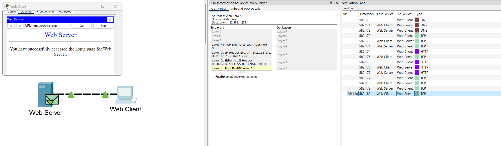
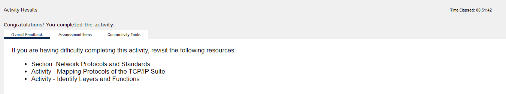

**Module:** IT533 Module 13, network models
**Tools:** Cisco Packet Tracer (Simulation mode)
**Devices:** Web Client (192.168.1.1) and Web Server (192.168.1.254) on one LAN
**Time:** 51 minutes 42 seconds (Packet Tracer timer)
**Score:** completed; this activity has no scored items, the grade is the answers

## What the lab asked for

Nothing to configure. The job is to watch one web request travel between a client and a server and read what each layer adds. Part 1: switch Packet Tracer to Simulation mode, show only HTTP events, open `www.osi.local` in the Web Client's browser, step through the events with Capture/Forward, and read the OSI Model tab and the PDU Details tabs. Part 2: show all event types and look at the DNS, ARP and TCP events that happen around the HTTP request. Two challenge questions ask which ports the server listens on.

## What I typed

On Web Client, Desktop, Web Browser:

```
www.osi.local
```

Then Capture/Forward to step through the events, clicking the colored box of an event to open its PDU window.



## The lab's questions

My answers, as I wrote them down during the lab.

**Part 1, HTTP web traffic**

**Look at the Web Client web browser page. Did anything change?** Yes, the browser page changed from a blank page to a page with a message on it. Message reads “You have successfully accessed the home page for Web Server”.

**What information is listed in the numbered steps directly below the In Layers and Out Layers boxes for Layer 7?** 1. The HTTP client sends a HTTP request to the server.

**What is the Dst Port value for Layer 4 under the Out Layers column?** Port 80

**What is the Dest. IP value for Layer 3 under the Out Layers column?** 192.168.1.254

**What information is displayed at Layer 2 under the Out Layers column?** Ethernet II Header 0060.47CA.4DEE >> 0001.96A9.401D

**What is the common information listed under the IP section of PDU Details as compared to the information listed under the OSI Model tab? With which layer is it associated?** Source and Destination IP address associated with Layer 3.

**What is the common information listed under the TCP section of PDU Details, as compared to the information listed under the OSI Model tab, and with which layer is it associated?** Destination And source port at Layer 4.

**What is the Host listed under the HTTP section of the PDU Details? What layer would this information be associated with under the OSI Model tab?** Host www.osi.local at layer 7.

**Comparing the information displayed in the In Layers column with that of the Out Layers column, what are the major differences?**

- DEST ADDR:0001.96A9.401D and SRC ADDR:0060.47CA.4DEE on inbound changes to DEST ADDR:0060.47CA.4DEE and SRC ADDR:0001.96A9.401D on outbound tabs.
- The TL number changes from 122 to 292.
- The source and destination IP address swap places on the in/outbound tabs.
- The source and destination ports swap places on the in/outbound tabs.
- The acknowledgement number changes from 1 to 103.
- Window changes from 65535 to 16384.
- HTTP Request on inbound is – HTTP Data:Accept-Language: en-usAccept: */*Connection: closeHost: www.osi.local
- And on outbound it is – HTTP Data:Connection: closeContent-Length: 170Content-Type: text/htmlServer: PT-Server/5.2

**How many tabs are displayed with this event?** Two tabs the OSI model tab and the Inbound tab is displayed in this event because the reply from the server has reached the requesting host.

**Part 2, other protocols in the TCP/IP suite**

**What additional Event Types are displayed?** DNS, ARP, & TCP

**What information is listed in the NAME field: in the DNS QUERY section?** www.osi.local

**At which device was the PDU captured?** The web client

**What is the value listed next to ADDRESS: in the DNS ANSWER section of the Inbound PDU Details?** 192.168.1.254

**In the numbered list directly below the In Layers and Out Layers, what is the information displayed under items 4 and 5?** TCP connection is successful and the device state is set to ESTABLISHED.

**What is the purpose of this event, based on the information provided in the last item in the list (should be item 4)?** To close the connection and set the connection state to CLOSED

**Challenge questions**

**Based on the information that was inspected during the Packet Tracer capture, what port number is the Web Server listening on for the web request?** Port 80

**What port is the Web Server listening on for a DNS request?** Port 53

## Proof it worked


