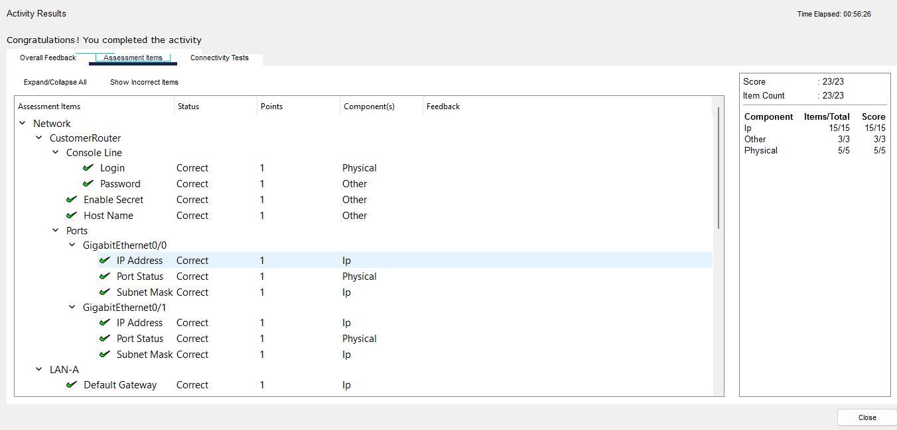
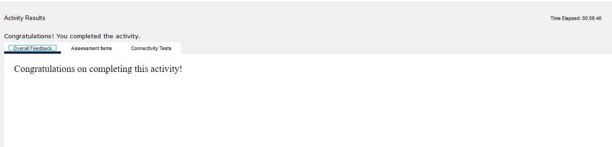

**Module:** IT533 Module 13, IPv4 subnetting
**Tools:** Cisco Packet Tracer
**Devices:** CustomerRouter and ISPRouter joined by a serial WAN link; two customer LAN switches with PC-A and PC-B behind them; plus the ISP switch, workstation, and server
**Time:** 56 minutes 26 seconds (Packet Tracer timer)
**Score:** 23 / 23 (Check Results)

## What the lab asked for

Take one /24 network, 192.168.0.0/24, and carve it into subnets for a customer. LAN-A needs at least 50 host addresses, LAN-B needs at least 40, and I also need at least two spare subnets for future growth. No variable length masks — every subnet uses the same mask. Then apply the scheme to the addressing table, configure the CustomerRouter, the two switches, and the two PCs, and test it with ping.

## Part 1: Work out the subnet scheme

**How many host addresses are needed in the largest required subnet?** 50 host addresses

**What is the minimum number of subnets required?** 4 is the minimum number of subnets (LAN-A, LAN-B, and two spares)

**What is the /24 subnet mask in binary?** 11111111.11111111.11111111.00000000

**In the network mask, what do the ones represent?** The network portion

**In the network mask, what do the zeros represent?** The host portion

**How many subnets and how many hosts does each mask create?** (borrowing bits past the /24)

| Prefix | Dotted decimal | Subnets | Hosts per subnet |
|---|---|---|---|
| /25 | 255.255.255.128 | 2 | 126 |
| /26 | 255.255.255.192 | 4 | 62 |
| /27 | 255.255.255.224 | 8 | 30 |
| /28 | 255.255.255.240 | 16 | 14 |
| /29 | 255.255.255.248 | 32 | 6 |
| /30 | 255.255.255.252 | 64 | 2 |

**Which mask meets the minimum host requirement, the minimum subnet requirement, and both at once?** 255.255.255.192 meets the requirements. It gives 4 subnets of 62 hosts each — enough hosts for LAN-A's 50 and LAN-B's 40, and enough subnets for the two LANs plus two spares.

**The subnets derived from 255.255.255.192** (block size of 64 in the last octet):

| Subnet Address | Prefix | Subnet Mask |
|---|---|---|
| 192.168.0.0 | /26 | 255.255.255.192 |
| 192.168.0.64 | /26 | 255.255.255.192 |
| 192.168.0.128 | /26 | 255.255.255.192 |
| 192.168.0.192 | /26 | 255.255.255.192 |

## The addressing table

LAN-A got the first subnet, LAN-B got the second. The router interface is the first host of each subnet, the switch is the second host, and the PC is the last host.

| Device | Interface | IP Address | Subnet Mask | Default Gateway |
|---|---|---|---|---|
| CustomerRouter | G0/0 | 192.168.0.1 | 255.255.255.192 | N/A |
| CustomerRouter | G0/1 | 192.168.0.65 | 255.255.255.192 | N/A |
| CustomerRouter | S0/1/0 | 209.165.201.2 | 255.255.255.252 | N/A |
| LAN-A Switch | VLAN1 | 192.168.0.2 | 255.255.255.192 | 192.168.0.1 |
| LAN-B Switch | VLAN1 | 192.168.0.66 | 255.255.255.192 | 192.168.0.65 |
| PC-A | NIC | 192.168.0.62 | 255.255.255.192 | 192.168.0.1 |
| PC-B | NIC | 192.168.0.126 | 255.255.255.192 | 192.168.0.65 |

The S0/1/0 link out to the ISP is a /30 (255.255.255.252) — a point-to-point link with exactly two usable hosts, one for each router end. The ISP side (209.165.200.x and 209.165.201.1) came pre-filled as the example to follow.

## What I typed

On **CustomerRouter**, from global config — hostname, the enable secret and console password the lab specified, then the two LAN interfaces:

```
hostname CustomerRouter
enable secret <lab enable secret>
line console 0
 password <lab console password>
 login
 exit
interface GigabitEthernet0/0
 ip address 192.168.0.1 255.255.255.192
 no shutdown
 exit
interface GigabitEthernet0/1
 ip address 192.168.0.65 255.255.255.192
 no shutdown
 exit
end
write memory
```

On each **customer switch**, the management address on VLAN 1 plus its default gateway (shown here for LAN-A; LAN-B uses .66 and gateway .65):

```
interface vlan 1
 ip address 192.168.0.2 255.255.255.192
 no shutdown
 exit
ip default-gateway 192.168.0.1
```

On **PC-A and PC-B**, I set the IP address, subnet mask, and default gateway from the Desktop > IP Configuration window to match the addressing table.

## Part 3: Test the network

**Can PC-A reach its default gateway?** Yes

**Can PC-B reach its default gateway?** Yes

**Can PC-A reach PC-B?** Yes

All three pings replied, which means the subnetting, the masks, and the gateways are all consistent across the router, switches, and PCs.

## Proof it worked




