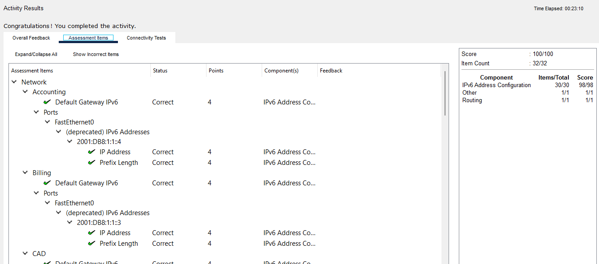
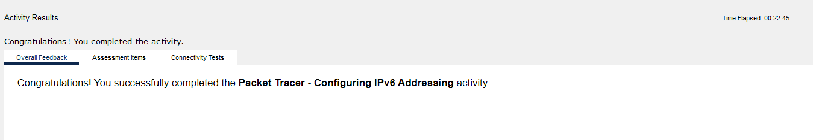

**Module:** IT533 Module 13, IPv6 addressing
**Tools:** Cisco Packet Tracer
**Devices:** R1 with two LANs — LAN 1 (Sales, Billing, Accounting) on G0/0 and LAN 2 (Design, Engineering, CAD) on G0/1 — plus a serial link to the ISP router
**Time:** 23 minutes (Packet Tracer timer)
**Score:** 100 / 100, 32 / 32 items (Check Results)

## What the lab asked for

Set up IPv6 by hand across the whole little network: turn on IPv6 routing and address the three router interfaces, then address the six hosts and the servers, then prove it works by loading the server web pages and pinging the ISP. The trick of the lab is that every interface gets **two** IPv6 addresses — a global one and a link-local one — and the hosts all use the router's link-local address as their gateway.

## The addressing table

| Device | Interface | IPv6 Address / Prefix | Default Gateway |
|---|---|---|---|
| R1 | G0/0 | 2001:db8:1:1::1/64 | N/A |
| R1 | G0/0 | fe80::1 (link-local) | N/A |
| R1 | G0/1 | 2001:db8:1:2::1/64 | N/A |
| R1 | G0/1 | fe80::1 (link-local) | N/A |
| R1 | S0/0/0 | 2001:db8:1:a001::2/64 | N/A |
| R1 | S0/0/0 | fe80::1 (link-local) | N/A |
| Sales | NIC | 2001:db8:1:1::2/64 | fe80::1 |
| Billing | NIC | 2001:db8:1:1::3/64 | fe80::1 |
| Accounting | NIC | 2001:db8:1:1::4/64 | fe80::1 |
| Design | NIC | 2001:db8:1:2::2/64 | fe80::1 |
| Engineering | NIC | 2001:db8:1:2::3/64 | fe80::1 |
| CAD | NIC | 2001:db8:1:2::4/64 | fe80::1 |
| ISP | S0/0/0 | 2001:db8:1:a001::1 | fe80::1 |

## What I typed

On **R1**, I first turned on IPv6 forwarding (it is off by default), then gave each interface its global address, its link-local address, and a `no shutdown`:

```
enable
configure terminal
ipv6 unicast-routing
interface GigabitEthernet0/0
 ipv6 address 2001:db8:1:1::1/64
 ipv6 address fe80::1 link-local
 no shutdown
 exit
interface GigabitEthernet0/1
 ipv6 address 2001:db8:1:2::1/64
 ipv6 address fe80::1 link-local
 no shutdown
 exit
interface Serial0/0/0
 ipv6 address 2001:db8:1:a001::2/64
 ipv6 address fe80::1 link-local
 no shutdown
 exit
end
show ipv6 interface brief
copy running-config startup-config
```

`ipv6 unicast-routing` is the one that makes R1 actually route IPv6 between the LANs. Each interface carries a global address (the routable `2001:db8` one) and a link-local `fe80::1`, which is the gateway the hosts point at.

On each **server and client**, from the Desktop tab > IP Configuration, I set the IPv6 address and prefix from the table and set the IPv6 gateway to **fe80::1**. For example, Accounting is `2001:db8:1:1::4` / `64` with gateway `fe80::1`.

One thing to watch with IPv6: if you type an address wrong, the router *adds* it instead of replacing it, so you have to clear the bad one with `no ipv6 address <wrong address>` before the interface is clean.

## Test and verify

- From the clients, I opened the server web pages by entering the server IPv6 addresses in the Web Browser (`2001:db8:1:1::4` for Accounting, `2001:db8:1:2::4` for CAD). Both pages loaded.
- From a client Command Prompt, I pinged the ISP across the serial link:

```
ping 2001:db8:1:a001::1
```

The pings replied, which confirms IPv6 routing is working end to end — client, through R1, out to the ISP.

## Proof it worked




